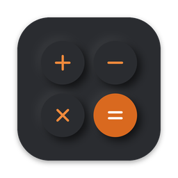
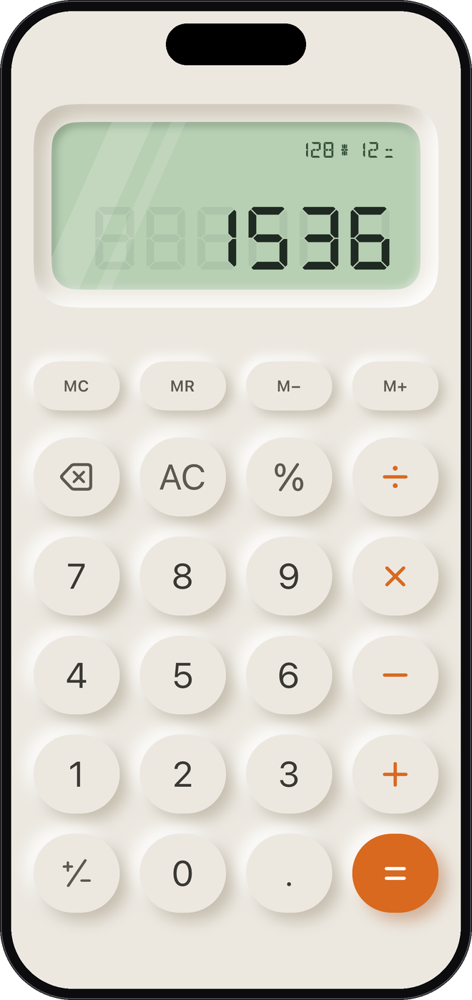
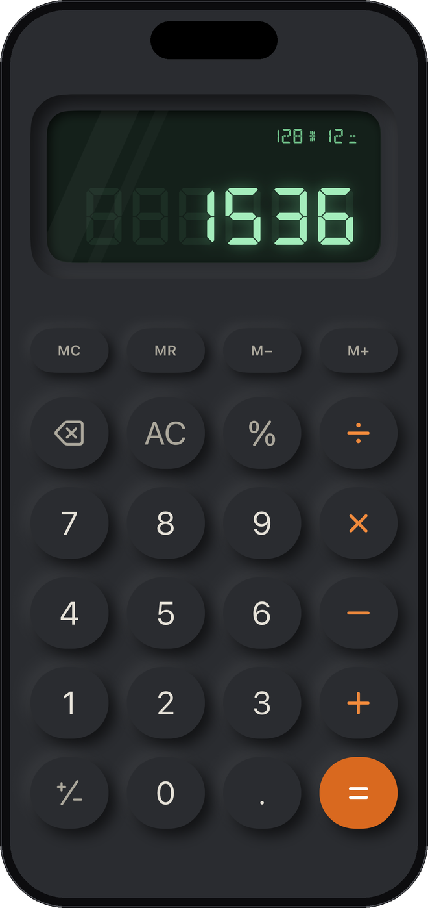
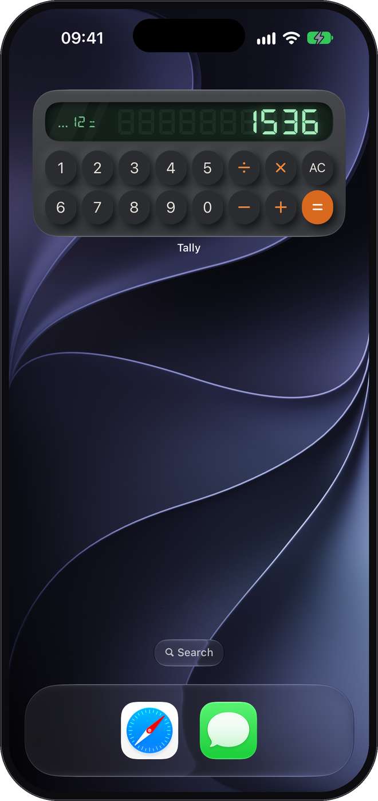

  

<h1 align="center">Tally</h1>

<h3 align="center">A calculator you’ll love to touch</h3>

  Soft, pressable keys. A glowing seven-segment LCD. Real desk-calculator clicks. 
  Tally makes everyday math feel like the calculator on your desk.

  
  
  

## Features

- **Feels real.** Neumorphic keys press in when you tap them, with optional desk-calculator click sounds and haptics.
- **Scientific mode.** Turn your phone sideways for trig, powers, roots, logarithms, parentheses and degrees/radians.
- **Home Screen widgets.** Calculate right from your Home Screen with interactive widgets — no need to open the app.
- **Memory & history.** MC, MR, M+ and M−, plus a history of results you can tap to reuse on larger screens.
- **Copy & paste.** Long-press the display to copy a result or paste a number from anywhere.
- **Everywhere you are.** iPhone, iPad, Mac, Apple Watch and Android, in Light and Dark Mode.

---

[Privacy Policy](privacy.md) · [Support](support.md) · Questions or bug reports: [open an issue](https://github.com/grighakobian/tally/issues/new)
